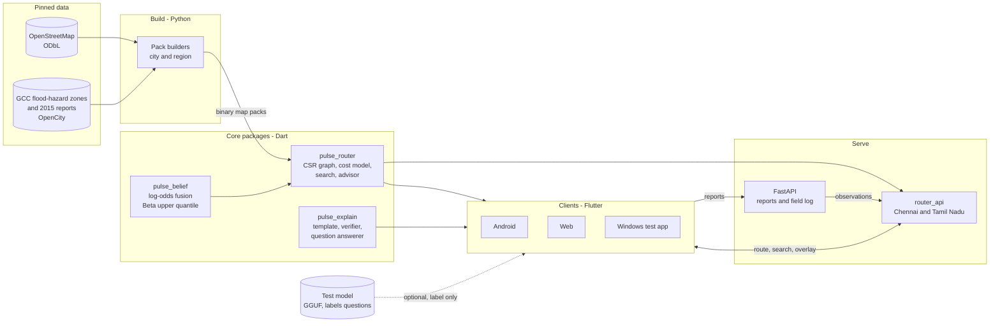
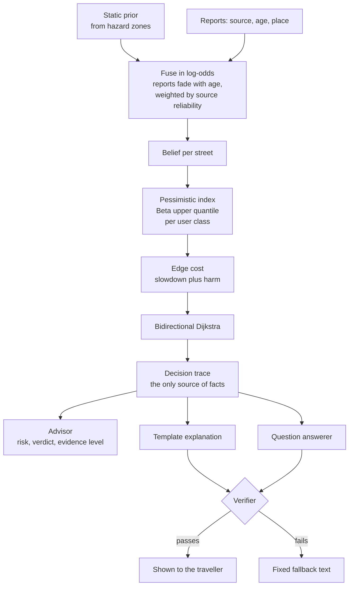
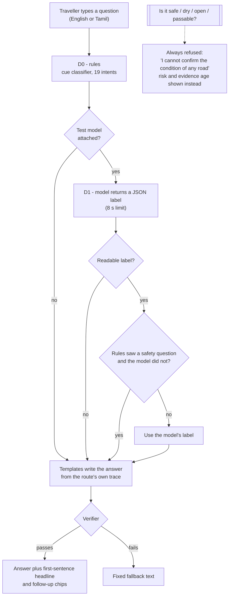

<div align="center">

# CityPulse AI

### Flood-aware navigation that tells you how much to trust it.

Offline-first routing for **Chennai and Tamil Nadu**, built on a per-street flood belief, a router that separates *slowdown* from *harm*,
explanations that a verifier checks before you see them, and a bilingual question box that never gives a safety verdict.

[](https://github.com/Pragatish616/CITYPULSE-IDP/actions/workflows/ci.yml)
[](https://github.com/Pragatish616/CITYPULSE-IDP/stargazers)
[](LICENSE)


**[Try the web demo](https://citypulse-idp.onrender.com)** ·
**[Download the Windows test app](https://github.com/Pragatish616/CITYPULSE-IDP/releases/tag/desktop-test-app)** ·
[Architecture](#architecture) ·
[What is different](#what-is-different) ·
[Results, including the failures](#what-the-evaluation-shows) ·
[Quick start](#quick-start) ·
[Roadmap](#roadmap)

</div>

> [!IMPORTANT]
> **CityPulse is a research prototype.** It estimates flood risk from limited data. It **never says a road is safe or passable**, and nothing here
> replaces your own judgement or official warnings. Flood data exists for **Chennai only**, built from 2015 records; there is no live sensor feed yet.
> The Android app has been installed and run on one phone; no timings, memory figures or offline tests are recorded yet.

---

## Why this exists

Every northeast monsoon Chennai floods in much the same places: Velachery, Pallikaranai, the railway subways, the Mudichur corridor. Two things go
wrong for people on the road. Navigation apps optimise travel time with little street-level flood information, and connectivity fails exactly when
it is needed.

CityPulse keeps a **flood probability for every road segment**, routes on a deliberately cautious version of it, explains the choice in plain language
from a checked record, and works without a network. It is also an honest research artifact: **the evaluation, including the results that went against
us, is in the repository.**

## Get it

| | | |
|---|---|---|
| 🌐 **Web demo** | Plan a route in your browser. Temporary, on a free host; may sleep for 30 to 60 seconds on first load. | [citypulse-idp.onrender.com](https://citypulse-idp.onrender.com) |
| 🖥️ **Windows test app** | The full app with the map **and the on-device test model inside** (473 MB zip). Unzip, run `citypulse_app.exe`. | [Release `desktop-test-app`](https://github.com/Pragatish616/CITYPULSE-IDP/releases/tag/desktop-test-app) |
| 📱 **Android app** | Built on demand by a GitHub workflow (64-bit ARM, debug-signed, for your own phone). | [Android APK workflow](.github/workflows/android-apk.yml) |
| 🧠 **Test model** | The fine-tuned question labeller (4-bit GGUF, 398 MB) with its licence and model card. Not adopted; see [below](#the-question-box-and-the-on-device-model). | [Release `qa-model-run1`](https://github.com/Pragatish616/CITYPULSE-IDP/releases/tag/qa-model-run1) |

## What is different

Most of the parts have prior art, and we say so ([literature review](03_literature_review/CityPulse_literature_review_v2.pdf), 323 verified references).
What this project adds is the combination, and the discipline around it.

| | |
|---|---|
| **Caution that rises when evidence thins** | The pessimistic index is a Beta-posterior upper quantile, so one positive report can never lower it. (The first version, a Wald band, did exactly that; it was found, documented and replaced, ADR-015.) |
| **Slowdown and harm are priced separately** | Edge cost is `time x (1 + p(slowdown - 1)) + lambda x p x severity x time`. A proposition in the docs shows that a time-proportional penalty caps cost at `(1 + lambda s)` times free-flow, which is why the default commuter setting is nearly hazard-blind. We measured it: 7 of 100 routes changed. |
| **No verdict, by construction** | No green, no "all clear", no percentages for model scores. Tests scan every UI string in both languages. A symbolic verifier gates generated text. A question about whether a road is safe, dry or open is **always refused**, with the risk and the age of the evidence shown instead. |
| **A question box that cannot talk its way past the rules** | Ask "why this route?", "how long?", "what did you avoid?", in English or Tamil. Rules answer first; a tiny model may only *label* the question; templates write the answer; the verifier checks it ([details](#the-question-box-and-the-on-device-model)). |
| **One router, every platform** | The Dart router runs on the server and in the app. Python re-implementations exist only for analysis and are validated against it (100 of 100 paths reproduced). |
| **Offline-first** | Compact CSR graph, bidirectional Dijkstra, binary map packs (Chennai: 471,240 edges; Tamil Nadu main roads: 257,249). The map tiles still need a network. |
| **Pre-registered evidence** | The recent studies and every model run state their pass criteria *before* they run. Missed bars are reported as missed. See [Results](#what-the-evaluation-shows). |
| **Bilingual from the start** | English and Tamil UI, search (streets, highway numbers, 25,144 places) and question answering. The Tamil is a first draft awaiting a native speaker's review. |
| **A way to get the missing data** | A volunteer field log (offline-first, *passable / not passable / can't tell*, with the time) and a subway watchlist from the city's own table, aimed at the one thing the models lack: independent, time-stamped street-level passability. |

## Architecture

### The system



### From evidence to a route to words



### The question box and the on-device model



The model **only labels**. It never sees the route's facts and never writes text a traveller reads; the guard means it can add caution but never remove it.
D0 always runs first and is the fallback, so a missing, slow or confused model costs wording, never correctness.

**What we measured, and what we did not** (pre-registered, ADR-035):

| Result | Value | Verdict |
|---|---|---|
| Fine-tune: Qwen2.5-0.5B-Instruct, LoRA, one GTX 1650, 3.7 hours | 525 steps | done |
| Labelling accuracy, 300 validation questions, 4-bit build, through the app's own runtime | **0.99** (bar 0.977) | met |
| Same, Tamil questions | 0.985 | met |
| Model writing the answer text, passing the verifier | 88.3% (bar 90%) | **missed, so the model is used for labelling only** |
| Untouched base model, same labelling task | 0.0 | reference |
| Speed on a laptop CPU | about 0.57 s per question | phone not measured |

The validation questions share a bank with the training questions, so these numbers overstate how it handles new phrasing. **Not adopted:** adoption needs a
sealed test set written by the team, blind ratings, a faithfulness audit and phone measurements. The model card is in
[`ml/route_qa/MODEL_CARD.md`](01_code/citypulse-IDP/ml/route_qa/MODEL_CARD.md).

## What the evaluation shows

The point of this repository is defensible measurement, so the negative results are part of the product.

- **Crowd reports added nothing measurable** over the static hazard map on the 2015 Chennai replay (193,191 nodes; 6,132 reports, all at one timestamp, none with depth).
- **The first pessimistic index was broken**: it lowered caution after one weak report. Replaced by a Beta-posterior upper quantile (ADR-015).
- **The belief is not calibrated.** The earlier model scored a *negative* Brier skill against climatology. The advisor's weights are hand-set placeholders; its outputs are scores, not measured frequencies.
- **A rain forecast did not help** (ADR-029): it missed its pre-registered bars, so it is off by default.
- **Terrain models do not locate flooded streets inside Chennai** (ADR-026, ADR-033, ADR-034): they work at state or basin scale; no learned prior kept routes out of the 2015 flood.
- **The fine-tuned model missed one of its bars** (above), and we kept it out of the answer text.
- **The scarce resource is data, not modelling:** independent, time-stamped, street-level passability evidence.

Details: [`KNOWN_FLAWS.md`](00_START_HERE/KNOWN_FLAWS.md), [`KEY_NUMBERS.md`](00_START_HERE/KEY_NUMBERS.md), the
[decision records](01_code/citypulse-IDP/docs/DECISIONS.md) (ADR-001 to ADR-035) and the [pre-registrations](01_code/citypulse-IDP/data/qa/2026-10-13/PREREGISTRATION_QA.md).

## Quick start

**Requirements:** Dart 3.x, Flutter (stable) for the apps, Python 3.11+ for the scripts.

```bash
git clone https://github.com/Pragatish616/CITYPULSE-IDP.git
cd CITYPULSE-IDP/01_code/citypulse-IDP

# Core packages
(cd packages/pulse_router  && dart pub get && dart test)
(cd packages/pulse_belief  && dart pub get && dart test)
(cd packages/pulse_explain && dart pub get && dart test)

# Router API (Chennai + Tamil Nadu on one port)
cd services/router_api && dart pub get
CITY=tamil_nadu PORT=8080 dart run bin/server.dart

# Flutter app in the browser
cd ../../app && bash scripts/sync_data_assets.sh && flutter pub get
flutter run -d chrome --dart-define=CITY=tamil_nadu --dart-define=ROUTER_API_URL=http://localhost:8080

# Windows desktop test app (needs Windows Developer Mode); put the model at build/.../Release/models/route_qa.gguf
flutter run -d windows -t lib/main_desktop.dart --dart-define=CITY=chennai
```

As of 15 October 2026 the suites pass: **754** tests in `pulse_explain`, **221** Flutter app tests, **360** Python tests (1 skipped), and the GitHub CI
runs all of them. More: [Deploying](01_code/citypulse-IDP/docs/DEPLOY.md) · [Adding a city](01_code/citypulse-IDP/docs/ADDING_A_CITY.md) ·
[Python scripts and server](01_code/citypulse-IDP/README.md).

> The raw OpenStreetMap extract and the largest intermediate files are not in git. The map packs the app and server need **are** included under
> `01_code/citypulse-IDP/data/packs/`. See [`data/MANIFEST.md`](01_code/citypulse-IDP/data/MANIFEST.md) for provenance and how to rebuild.

## Repository map

```text
.
├── 00_START_HERE/        Status, known flaws (with file and line), next steps, key numbers
├── 01_code/
│   └── citypulse-IDP/    The codebase
│       ├── packages/       pulse_router · pulse_belief · pulse_explain   (Dart)
│       ├── app/            Flutter app: Android, web, Windows test app
│       ├── services/       router_api: Chennai + Tamil Nadu HTTP service  (Dart)
│       ├── server/         Report ingest and volunteer field log           (FastAPI)
│       ├── ml/             route_qa (question model: training, export, checks)
│       │                   event_miner (local model + review queue)        (Python)
│       ├── tools/          model_check: the model through the app's runtime (Dart)
│       ├── scripts/        Pack builders, replay engine, studies           (Python)
│       ├── config/         cities.yaml · hazard_classes.yaml
│       ├── data/           Pinned snapshots, map packs, results, pre-registrations
│       └── docs/           ADRs, contracts, architecture, deployment
├── 02_paper/             IEEE conference paper (PDF + LaTeX)
├── 03_literature_review/ Review (PDF + LaTeX) and 323 verified references
├── 04_critique_and_review/  Independent review and adjudication
├── 05_council/           Believer, Skeptic, Investor, Judge verdicts
├── 06_research_notes/    Verified literature tables, market brief
├── 07_reanalysis/        Study 1 re-scored under one reference belief
├── 08_archive_v1/        Superseded drafts, kept for history
└── CLAUDE.md · PLAN.md   Rules and the build plan for anyone, human or agent
```

## Roadmap

Full plan: [`PLAN.md`](PLAN.md). Gated next steps: [`NEXT_STEPS.md`](00_START_HERE/NEXT_STEPS.md).

- [x] Router, belief engine and explanation gate on the full Chennai graph
- [x] Beta-posterior pessimistic index, four travel modes, checked explanations
- [x] Chennai + Tamil Nadu in one app; on-device route advisor
- [x] Web demo; Android app installed and run on one phone
- [x] Volunteer field log, subway watchlist, rain-forecast input (failed its bar, off by default), event miner
- [x] **Question box in English and Tamil, with a verifier-gated, rules-first answerer**
- [x] **Fine-tuned on-device labelling model, exported to GGUF and run through the app's own runtime** (not adopted)
- [x] **Windows desktop test app with the map and the model, downloadable from a GitHub release**
- [ ] Measure latency, memory, battery and offline routing on a phone, including the model
- [ ] The team's sealed test set, blind ratings and faithfulness audit for the model
- [ ] Independent, time-stamped passability data: run the field log and the subway pilot with volunteers
- [ ] Native-speaker review of the Tamil text
- [ ] Other cities and states, one phase at a time

## Data, licences and credits

| Source | Use | Licence |
|---|---|---|
| OpenStreetMap | Roads, street and place names | ODbL 1.0 |
| Greater Chennai Corporation via OpenCity | Flood-hazard zones, 2015 reports | Public domain (one layer's origin terms unverified) |
| OpenFreeMap / OpenMapTiles | Base map tiles | See attribution on the map |
| Qwen2.5-0.5B-Instruct (Alibaba Cloud / Qwen team) | Base of the test model, changed by fine-tuning | Apache-2.0 |

Every pinned file's provenance is in [`data/MANIFEST.md`](01_code/citypulse-IDP/data/MANIFEST.md). No Google Maps Platform data is used, and the project
does not bulk-use the public OpenStreetMap tile servers. **Code:** [MIT](LICENSE). Data keeps its own licences: OpenStreetMap-derived files, including the
map packs, stay under the ODbL and carry its share-alike terms.

## Contributing and conduct

Read [CONTRIBUTING.md](.github/CONTRIBUTING.md) first. In short: tests before changes, no invented numbers, and the wording rules in
[`CLAUDE.md`](CLAUDE.md) section 6. Security issues go through [SECURITY.md](.github/SECURITY.md). We follow the [Code of Conduct](.github/CODE_OF_CONDUCT.md).

## Team

**Pragatish N · Ravi R Kamath · Jyotish N**, B.Tech, VIT Chennai. A credited university IDP project.
